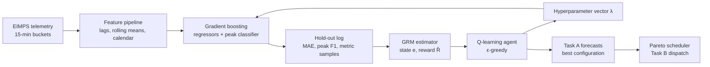

# Green-GRM: Generative Reward Machines for energy forecasting (GreenDIGIT 2026)

Code and data of the paper

> **Automated Hyperparameter Optimization for Energy Forecasting using
> Generative Reward Machines.** Saeid Rezaei. GreenDIGIT ECML-PKDD 2026
> Discovery Challenge, Naples, Italy, 2026.

The GreenDIGIT ECML-PKDD 2026 Discovery Challenge asks for forecasts of the
energy use and carbon footprint of research-infrastructure sites (Task A,
with invalid-signal and peak detection) and for a carbon-aware job scheduler
driven by these forecasts (Task B). Green-GRM treats the hyperparameter
selection of the gradient boosting models as a reinforcement learning
problem under noisy, partially observable evaluations: a Generative Reward
Machine (GRM) estimator, calibrated offline on evaluation logs, maps every
evaluation to one of a few estimated states and to an estimated reward, and a
tabular Q-learning agent selects hyperparameter vectors over these states. The
forecasts of the selected configuration drive a Pareto scheduler for Task B.
The submission (team ISystems) placed third in the challenge.



## Repository layout

```
.
├── green_grm/          implementation of the paper (Algorithm 1, baselines, Task B scheduler), see green_grm/README.md
├── challenge_code/     code of the challenge phase (experiment grid, evaluators, schedulers, diagnostics), see challenge_code/README.md
├── data/               public challenge data (telemetry, job trace, site registry), see data/README.md
├── task-a/             official Task A starter kit (evaluator, validators, baseline, API), unchanged
├── task-b/             official Task B starter kit (DIRAC-like simulator, evaluator, baselines), unchanged
├── results/            outputs of the runs reported below (logs, rankings, metrics, submission files)
├── static/             logos of the official kit
├── CHALLENGE_README.md README of the official challenge repository
├── requirements*.txt   Python dependencies (PyTorch only for the MLPs of the challenge-phase grid)
├── LICENSE
└── CITATION.cff
```

## Installation

Python 3.9 or newer.

```bash
python -m venv .venv && source .venv/bin/activate
pip install -r requirements.txt
# optional, for the PyTorch MLPs of challenge_code/task_a/model_lab.py:
pip install -r requirements-torch-cuda122.txt      # or requirements-torch-cuda114.txt
```

The official packages in `task-a/` and `task-b/` are found automatically; they
can also be installed with `pip install -e task-a` and `pip install -e task-b`
to use their command-line tools.

## Reproducing the results

All commands run from the repository root. Every script starts with a
`CONFIG` block listing the options and their alternatives, prints its
progress and stops if an input file is missing.

```bash
# Green-GRM search, the four baselines, final models and Task A scores
# (about 40 and 30 minutes on 2 CPU cores)
python green_grm/run_green_grm.py --protocol paper --run-name paper_protocol
python green_grm/run_green_grm.py --protocol challenge_lab --run-name challenge_lab_protocol

# Task B with the forecasts of the selected configuration
python green_grm/run_task_b.py --model-dir runs/paper_protocol/final_model/model

# challenge-phase code
python challenge_code/task_a/model_lab.py
python challenge_code/task_a/random_forest_baseline.py
python challenge_code/task_b/run_scheduler.py

# tests
cd green_grm && python -m pytest
```

`python green_grm/run_green_grm.py --quick` runs the whole pipeline with small
budgets in a few minutes. For the private test data of the challenge,
`green_grm/predict.py --model-dir ... --test-data ... --output ...` writes the
three Task A files of a trained model.

## Results

All numbers below were produced by the code in this repository on the public
data (2 CPU cores, Python 3.13, scikit-learn 1.9.1, pandas 3.0.5, seed 42); the
outputs are in `results/`. Other scikit-learn versions give slightly different
numbers: with Python 3.9, pandas 1.4 and scikit-learn 1.2 the feature
matrices are identical, but the gradient boosting models are not (Exp_21
below scores 0.3907 instead of 0.3889, for example). The challenge
leaderboard was computed by the organisers on hidden later months and cannot
be reproduced from the public files.

### Task A, protocol `paper` (method as described in Sect. 4)

Search on the hold-out at the end of the training period (search-train up to
2026-01-31 11:00, hold-out up to the cut-off), N0 = 24 offline and B = 60
online evaluations for Green-GRM and the same budget of 84 evaluations for
each baseline. Each selected configuration was then retrained on all data up
to the cut-off and scored on the public test window with the official
evaluator (Eq. 2; lower is better; the starter-kit baseline scores 0.7646).

| Method | Selected λ (loss, η, T, d, ρ) | Evaluations | Hold-out J | Hold-out MAE | Hold-out peak F1 | Test ScoreTA (↓) | S(A)<sub>1h</sub> | S(A)<sub>24h</sub> | S(A.2) |
| --- | --- | --- | --- | --- | --- | --- | --- | --- | --- |
| Green-GRM | absolute, η 0.075, T 100, d 5, ρ 20 | 84 | 1.2764 | 146.74 | 0.422 | **0.6112** | 0.7296 | 0.8406 | 0.4107 |
| scikit-learn default | squared, η 0.1, T 100, d None, ρ 0 | 1 | 1.3726 | 169.23 | 0.432 | **0.6221** | 0.7640 | 0.8354 | 0.4151 |
| Random search | absolute, η 0.075, T 100, d None, ρ 22.5 | 84 | 1.2747 | 147.13 | 0.425 | **0.6116** | 0.7312 | 0.8439 | 0.4023 |
| Bayesian optimisation | absolute, η 0.05, T 150, d None, ρ 20 | 84 | 1.2733 | 147.32 | 0.427 | **0.6126** | 0.7309 | 0.8456 | 0.4055 |
| TPE | absolute, η 0.05, T 150, d None, ρ 20 | 84 | 1.2733 | 147.32 | 0.427 | **0.6126** | 0.7309 | 0.8456 | 0.4055 |

* Every search method settles on the absolute-error loss. The scikit-learn
  default (squared error, no L2 regularisation) has the highest hold-out J
  and the worst test score.
* Green-GRM selects absolute error, η 0.075, 100 iterations, depth 5 and
  ρ 20: the absolute-error loss, shallow trees and strong L2 regularisation
  reported in the paper, with a higher learning rate than the paper's 0.01.
  Its hold-out J is not the lowest of the four searches (Bayesian
  optimisation and TPE reach 1.2733), but its configuration gives the best
  test score of the five; the differences between the searched
  configurations are small (at most 0.0015).
* The reward estimator follows the observed objective closely: R² 0.87 on
  the 24 offline logs and a correlation of 0.98 between estimated and
  observed J over all 84 evaluations.
* The official baseline reads A.1 and A.2 from the telemetry of the bucket
  itself, which gives S(A.1) = S(A.2) = 0. Green-GRM derives A.1 from the
  validity of the telemetry in the same way (S(A.1) = 0) but predicts peaks
  one hour ahead, as in the paper, so S(A.2) counts in its score.

| Search trace (hold-out J of every evaluation and of the current selection) |
| --- |
|  |

| GRM estimator: estimated vs observed J, and the four estimated states |
| --- |
|  |

### Task A, protocol `challenge_lab` (challenge-phase pipeline)

The same search in the setting where the numbers of the paper were obtained:
one-hour models of the challenge feature library (used for both horizons),
hold-out = public buckets after the cut-off, which are also the scored
buckets. The composite score is the challenge-phase score
(F1 A.1 + F1 A.2 + 0.5 / (1 + MAE energy) + 0.5 / (1 + MAE carbon)) / 3,
higher is better.

| Method | Selected λ (loss, η, T, d, ρ) | Evaluations | Composite score (↑) | Energy MAE | Peak F1 | A.1 F1 | Official ScoreTA (↓) |
| --- | --- | --- | --- | --- | --- | --- | --- |
| Green-GRM | absolute, η 0.1, T 50, d 5, ρ 20 | 84 | **0.38905** | 164.88 | 0.195 | 0.9661 | 0.5935 |
| scikit-learn default | squared, η 0.1, T 100, d None, ρ 0 | 1 | **0.38878** | 183.81 | 0.195 | 0.9658 | 0.6137 |
| Random search | absolute, η 0.1, T 50, d 5, ρ 22.5 | 84 | **0.38904** | 164.99 | 0.195 | 0.9661 | 0.5952 |
| Bayesian optimisation | absolute, η 0.05, T 100, d 5, ρ 20 | 84 | **0.38893** | 164.77 | 0.195 | 0.9658 | 0.5942 |
| TPE | absolute, η 0.05, T 100, d 5, ρ 20 | 84 | **0.38893** | 164.77 | 0.195 | 0.9658 | 0.5942 |

* Green-GRM selects absolute error, η 0.1, 50 iterations, depth 5 and ρ 20
  (energy MAE 164.88, composite 0.38905); random search finds a neighbour of
  it (ρ 22.5) and Bayesian optimisation and TPE the lowest energy MAE
  (164.77). The energy MAE of all searched configurations, 164.8 to 165.0,
  matches the MAE of 164.78 in Table 2 of the paper.
* The peak F1 is 0.195 for every configuration: the challenge-phase
  classifiers take only the number of iterations from λ, and early stopping
  ends the peak classifier after 43 iterations in all cases.
* The estimator is weaker here (R² 0.50 on the offline logs) because J
  depends on the energy error alone while P1 averages the energy, carbon and
  peak errors.
* The composite score is dominated by the two F1 terms (about 0.97 and
  0.195), so the forecast error moves it only in the fourth decimal; even the
  scikit-learn default, with a much higher MAE, is within 0.0003.
* The hold-out of this protocol is the scored window, so these numbers
  describe the challenge-phase selection, not an independent test.

### Task B (forecast-driven Pareto scheduling)

Replay of the 5,938 jobs of the public test window (2026-02-18 14:15 to
2026-03-12 17:00) in the official simulator, scored against FCFS with the
official evaluator (Eq. 3; higher is better; declared objective: carbon). The
scheduler decides on the forecasts of the selected `paper`-protocol model
only; the simulator charges every job the measured energy and carbon of its
dispatch bucket, as in the official offline mode.

| Scheduler | Task B score (↑) | Pareto | Declaration bonus | Deadline penalty | ΔEnergy | ΔCarbon | ΔMakespan | Jobs dispatched / jobs |
| --- | --- | --- | --- | --- | --- | --- | --- | --- |
| FCFS (reference) | 0.0000 | 0.0000 | 0.0000 | 0.0000 | 0.0000 | 0.0000 | 0.0000 | - |
| greedy_carbon (official baseline) | **0.0125** | 0.0152 | 0.0023 | 0.0050 | +0.0207 | +0.0150 | +0.0099 | 5,879 / 5,938 |
| Green-GRM Pareto scheduler, Green-GRM forecasts | **0.1414** | 0.1125 | 0.0289 | 0.0000 | +0.1446 | +0.1928 | +0.0000 | 5,938 / 5,938 |
| Same scheduler, measured signals (oracle) | **0.5840** | 0.4711 | 0.1128 | 0.0000 | +0.6612 | +0.7522 | +0.0000 | 5,938 / 5,938 |

Forecast-to-dispatch value gap: 0.4426, capture ratio 0.242 (score with forecasts / score with measured signals).

* With the Green-GRM forecasts the scheduler lowers the energy charged to the
  jobs by 14.5 % and the carbon by 19.3 % and dispatches every job within its
  deadline. The official `greedy_carbon` baseline gains little and leaves 59
  jobs undispatched at the end of the window, because jobs deferred
  independently converge on the same bucket.
* Fed with the measured signals instead of forecasts, the same scheduler
  reaches 0.584: about a quarter of the attainable gain is captured with
  forecasts (capture ratio 0.24, the forecast-to-dispatch value gap of the
  challenge specification).

### The numbers reported in the paper

The paper reports a challenge score of 0.38615 with an MAE of 164.78 and a
peak-detection F1 of 0.184 for the selected configuration. These values match
the scale of the composite score of the challenge-phase code
(`challenge_code/task_a/composite_evaluator.py`, higher is better); on the
scale of Eq. 2 (lower is better) the same models score about 0.60. In the
challenge-phase pipeline:

| Configuration | Composite score | Energy MAE | Peak F1 | Official ScoreTA (Eq. 2) |
| --- | --- | --- | --- | --- |
| Exp_21 of the challenge grid (absolute error, η 0.05, T 100, ρ 0.5) | 0.38892 | 166.17 | 0.195 | 0.5958 |
| Configuration of Table 2 (absolute error, η 0.01, T 200, d 5, ρ 25) | 0.38900 | 167.14 | 0.195 | 0.6015 |
| Reported in the paper | 0.38615 | 164.78 | 0.184 | - |

With scikit-learn 1.9.1, Exp_21 is reproduced to the last digit of the
archived `super.py` output. The search run behind the reported values is not
part of the archive, so they are matched to within 0.003 but not exactly.

## Data

`data/` holds the public files of the official challenge repository (EIMPS
telemetry of three anonymised sites at 15-minute resolution, November 2025
to March 2026, with the Task B job trace and site registry); see
`data/README.md`. The event-level file `summary_sites_raw.csv` (about 0.9 GB)
is only distributed through the challenge VRE.

## Citation

```bibtex
@inproceedings{rezaei2026greengrm,
  author    = {Rezaei, Saeid},
  title     = {Automated Hyperparameter Optimization for Energy Forecasting using Generative Reward Machines},
  booktitle = {GreenDIGIT ECML-PKDD 2026 Discovery Challenge},
  address   = {Naples, Italy},
  year      = {2026}
}
```

The GRM framework is described in S. Rezaei, *Generative Reward Machines for
Reinforcement Learning in Problems with Poor Observability*, PhD thesis,
University College Cork (https://cora.ucc.ie/items/6cf46796-173c-4426-99bd-676e11656485).

## Licence and acknowledgements

The code in `green_grm/` and `challenge_code/` is released under the MIT
licence (`LICENSE`). `task-a/`, `task-b/`, `data/` and `static/` come from the
official GreenDIGIT ECML-PKDD 2026 challenge repository
(https://gd2.lab.uvalight.net/) and keep their original terms; the challenge
is organised by the GreenDIGIT project, funded by the European Union's Horizon
Europe programme (grant agreement No. 101131207).
